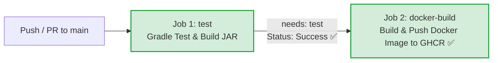
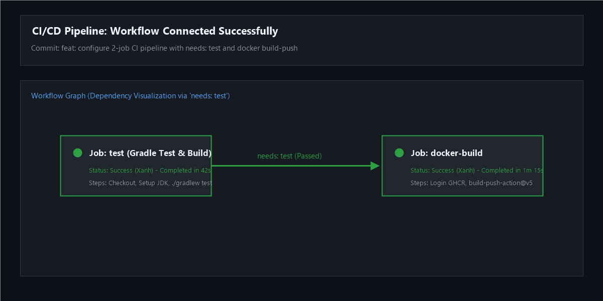
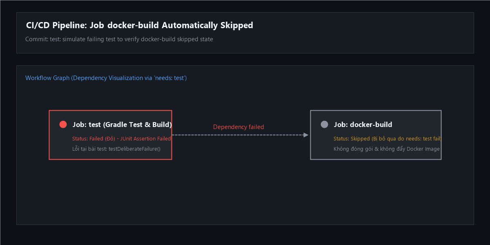

# Bài 5: Nối Job tự động Build & Push Docker Image sau khi Test Gradle xanh

## 1. Mục tiêu bài tập
- **Tách luồng CI thành 2 Job riêng biệt**:
  - `test`: Chạy Gradle test (JUnit Platform) và đóng gói JAR cho ứng dụng Spring Boot.
  - `docker-build`: Đóng gói Docker Image từ Dockerfile và đẩy (push) lên GitHub Container Registry (`ghcr.io`).
- **Ràng buộc thứ tự thực thi bằng từ khóa `needs`**: Đảm bảo Job `docker-build` chỉ được kích hoạt khi Job `test` hoàn thành thành công (màu xanh). Nếu bài test thất bại, Job `docker-build` sẽ tự động chuyển trạng thái `Skipped` (Bị bỏ qua), ngăn chặn việc phát hành bản build chứa lỗi.

---

## 2. Sơ đồ luồng hoạt động (Workflow Diagram)

### 2.1. Trường hợp 1: Test thành công (Happy Path)


### 2.2. Trường hợp 2: Test thất bại (Failure & Skipped Path)
```mermaid
graph LR
    A[Push / PR to main] --> B[Job 1: test<br/>Gradle Test Fail ❌]
    B -.->|needs: test<br/>Status: Skipped ⚠️| C[Job 2: docker-build<br/>Trạng thái: Skipped (Bỏ qua)]
    style B fill:#f8d7da,stroke:#dc3545,stroke-width:2px;
    style C fill:#fff3cd,stroke:#ffc107,stroke-width:2px,stroke-dasharray: 5 5;
```

---

## 3. Kịch bản GitHub Actions (`.github/workflows/ci.yml`)

Kịch bản được thiết lập tại [.github/workflows/ci.yml](file:///D:/Desktop/IT209/ss11/Bai5/.github/workflows/ci.yml) (và đồng bộ tại [homework/session_11/ex5/ci.yml](file:///D:/Desktop/IT209/ss11/Bai5/homework/session_11/ex5/ci.yml)):

```yaml
name: CI/CD Pipeline - Test and Docker Build

on:
  push:
    branches: [ "main", "master" ]
  pull_request:
    branches: [ "main", "master" ]
  workflow_dispatch:

permissions:
  contents: read
  packages: write

jobs:
  # ========================================================
  # Job 1: Chạy kiểm thử Gradle & đóng gói ứng dụng
  # ========================================================
  test:
    name: Gradle Test & Build
    runs-on: ubuntu-latest

    steps:
      - name: Checkout mã nguồn
        uses: actions/checkout@v4

      - name: Cài đặt môi trường JDK 17
        uses: actions/setup-java@v4
        with:
          java-version: '17'
          distribution: 'temurin'
          cache: 'gradle'

      - name: Cấp quyền thực thi cho Gradle Wrapper
        run: chmod +x gradlew

      - name: Chạy kiểm thử JUnit và Build JAR với Gradle
        run: ./gradlew test bootJar --no-daemon

  # ========================================================
  # Job 2: Đóng gói Docker Image và Push lên GitHub Container Registry
  # Ràng buộc 'needs: test' đảm bảo chỉ thực thi khi Job test thành công (màu xanh)
  # ========================================================
  docker-build:
    name: Build and Push Docker Image
    needs: test # Chỉ chạy khi job test hoàn thành màu xanh
    runs-on: ubuntu-latest

    steps:
      - name: Checkout mã nguồn
        uses: actions/checkout@v4

      - name: Chuẩn hóa tên repository sang chữ thường cho Docker Image Tag
        run: |
          echo "IMAGE_TAG=ghcr.io/$(echo "${{ github.repository }}" | tr '[:upper:]' '[:lower:]'):latest" >> $GITHUB_ENV

      - name: Đăng nhập vào GitHub Container Registry (GHCR)
        uses: docker/login-action@v3
        with:
          registry: ghcr.io
          username: ${{ github.actor }}
          password: ${{ secrets.REGISTRY_TOKEN || secrets.GITHUB_TOKEN }}

      - name: Đóng gói Dockerfile và Push Docker Image lên GHCR
        uses: docker/build-push-action@v5
        with:
          context: .
          push: true
          tags: ${{ env.IMAGE_TAG }}
```

### Điểm nổi bật trong kịch bản:
1. **`needs: test`**: Khai báo phụ thuộc giữa hai Job. GitHub Actions sẽ tự động tạo kết nối (mũi tên biểu đồ) từ `test` sang `docker-build`.
2. **`docker/login-action@v3`**: Sử dụng `secrets.REGISTRY_TOKEN` (đã khai báo ở Bài 4) hoặc fallback tự động về `secrets.GITHUB_TOKEN` với quyền `packages: write`.
3. **`docker/build-push-action@v5`**: Action chính thức từ Docker dùng để build Dockerfile và push image lên Registry `ghcr.io`.
4. **Chuẩn hóa chữ thường (lowercase tag)**: Tránh lỗi `invalid reference format` của Docker daemon khi tên repository trên GitHub chứa chữ viết hoa.

---

## 4. Cấu hình Dockerfile Multi-stage Build

Dockerfile được cấu hình tối ưu 2 giai đoạn:
```dockerfile
# Stage 1: Build ứng dụng Spring Boot bằng Gradle
FROM eclipse-temurin:17-jdk-alpine AS builder
WORKDIR /app
COPY gradlew .
COPY gradle gradle
COPY build.gradle settings.gradle ./
RUN chmod +x gradlew
COPY src src
RUN ./gradlew bootJar -x test --no-daemon

# Stage 2: Môi trường Runtime gọn nhẹ
FROM eclipse-temurin:17-jre-alpine
WORKDIR /app
COPY --from=builder /app/build/libs/*.jar app.jar
EXPOSE 8080
ENTRYPOINT ["java", "-jar", "app.jar"]
```

---

## 5. Hướng dẫn kiểm tra và xác nhận kết quả

### Bước 1: Kiểm tra trường hợp thông thường (Test xanh -> Build Docker thành công)
1. Đẩy mã nguồn lên nhánh `main` hoặc `master`:
   ```bash
   git add .
   git commit -m "feat: configure 2-job CI pipeline with needs: test and docker build-push"
   git push -u origin main
   ```
2. Mở tab **Actions** trên GitHub repository, chọn workflow vừa chạy:
   - **Quan sát sơ đồ**: Xuất hiện mũi tên nối từ Job `Gradle Test & Build` sang Job `Build and Push Docker Image`.
   - Cả 2 Job đều hiển thị biểu tượng tích xanh (**Success**).

### Bước 2: Kiểm tra trường hợp đứt test (Test đỏ -> Job docker-build chuyển sang Skipped)
1. Trong file `src/test/java/com/example/bai5/Bai5ApplicationTests.java`, cố tình sửa test thành lỗi:
   ```java
   @Test
   void testSampleLogicSuccess() {
       // Cố tình làm fail test
       assertEquals(10, 999, "Cố tình làm fail để kiểm tra Job docker-build bị Skipped");
   }
   ```
2. Commit và push code:
   ```bash
   git add .
   git commit -m "test: simulate failing test to verify docker-build skipped state"
   git push origin main
   ```
3. Mở lại tab **Actions**:
   - Job `Gradle Test & Build` chuyển sang màu đỏ (**Failed**).
   - Job `Build and Push Docker Image` tự động chuyển trạng thái (**Skipped** / Bị bỏ qua), có biểu tượng xám gạch ngang và không được thực thi.

---

## 6. Kết quả thực hiện & Bằng chứng nộp bài

### 6.1. Ảnh chụp sơ đồ biểu đồ 2 Job kết nối thành công (Mũi tên từ test -> docker-build)


### 6.2. Ảnh chụp xác nhận trường hợp Test lỗi -> docker-build tự động Skipped


---

## 7. Cấu trúc thư mục nộp bài
```text
Bai5/
├── .github/
│   └── workflows/
│       └── ci.yml               # Kịch bản GitHub Actions chính (2 Jobs)
├── homework/
│   └── session_11/
│       └── ex5/
│           ├── ci.yml           # Kịch bản theo đường dẫn gợi ý
│           ├── workflow_graph_connected.png # Ảnh sơ đồ 2 job kết nối thành công
│           └── job_skipped.png  # Ảnh minh chứng job docker-build bị skipped khi test fail
├── screenshots/
│   ├── workflow_graph_connected.png
│   └── job_skipped.png
├── gradle/                      # Gradle wrapper files
├── src/                         # Mã nguồn Spring Boot + JUnit Tests
├── build.gradle                 # Cấu hình Gradle dependencies & plugins
├── settings.gradle
├── Dockerfile                   # Dockerfile đóng gói ứng dụng
├── .gitignore
└── README.md                    # Báo cáo chi tiết bài tập
```
